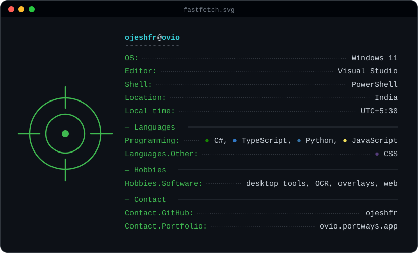

<h1 align="center">Hey, I'm Ojesh</h1>

<em>turning rabbit holes into repos. (holy bars)</em>

<a href="https://ovio.portways.app">ovio.portways.app</a>

Live: served by a small Cloudflare Worker. Buttons count once per visitor per minute.

